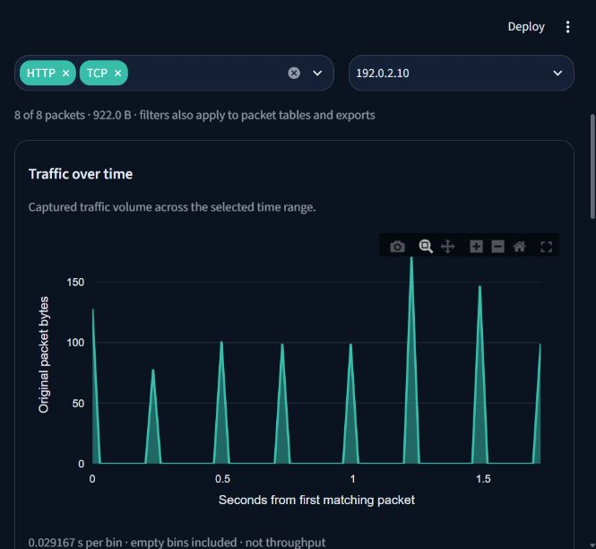
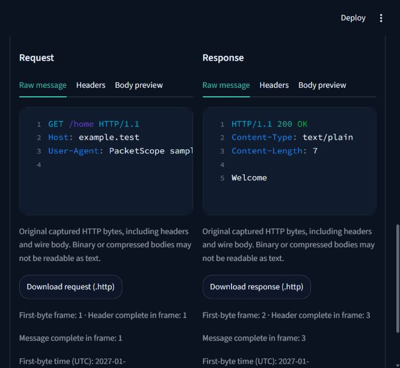

# PacketScope - Capture Analysis Dashboard

A Python dashboard for inspecting PCAP/PCAPNG captures, reconstructing plaintext HTTP/1.x transactions and asking evidence-backed questions. Built for Assignment 1 (2026-2027), Part C, requirements 23-34.

The English interface includes Light/Dark/System themes, interactive charts, selectable tables, full captured HTTP messages and JSON/CSV exports. Capture analysis runs locally. AI is optional: use free offline Qwen after setup, or configure your own Gemini key.



## Install and run on Windows

Install **Python 3.12 or 3.13** and **Git**. Windows with Python 3.12 is the tested environment. The course demonstration environment still needs to be confirmed. Internet access is needed to install dependencies and download the optional local model. Reading captures does not require Wireshark, Npcap or administrator privileges.

```powershell
git clone https://github.com/IdanZR/packetscope-dashboard.git
cd packetscope-dashboard
py -3.12 -m venv .venv
.\.venv\Scripts\python.exe -m pip install -r requirements.txt
.\.venv\Scripts\python.exe -m streamlit run app.py
```

This repository is private: cloning requires access through your own GitHub account. If using the source ZIP, extract it and open PowerShell inside `traffic_dashboard` instead of running the first two commands. With Python 3.13, replace `-3.12` with `-3.13`; if `py` is unavailable, use `python`.

Open **http://127.0.0.1:8501**. Stop the server with **Ctrl+C**. No PowerShell activation or Execution Policy change is required.

For a shortcut, run **`start.bat`** from the extracted/cloned directory. It creates `.venv` and installs core dependencies on the first run. If you already created an empty `.venv`, install `requirements.txt` manually before using the shortcut.

### Optional AI setup

| Mode | Setup | Network during questions |
|---|---|---|
| Capture/HTTP analysis | Core installation above | None |
| Local Qwen on CPU | Run `scripts/setup_ai.bat` once, then `start.bat` | None after setup |
| Gemini | Run `scripts/start_gemini.bat`, enter your key in the hidden prompt | Required |

Local setup downloads about **640 MB** of model weights, stored in `.local_ai/` and excluded from Git/source archives. It installs a CPU wheel through `requirements/local-ai.txt`. See [LOCAL_AI.md](docs/LOCAL_AI.md) for manual commands, compatibility, model sources and license information.

For Gemini, you can also choose **AI settings > Gemini** and use the password field for a session key. The application reads `GEMINI_API_KEY` if supplied by your own environment. Keys remain in process/session memory. Gemini receives your question and limited extracted HTTP metadata; raw captures, message headers and bodies are not sent. Account quotas and pricing apply. See [GEMINI.md](docs/GEMINI.md).

The normal test suite needs neither a model download nor an API key.

### macOS / Linux

These standard commands are provided for portability; they have not been validated on those operating systems:

```bash
python3 -m venv .venv
.venv/bin/python -m pip install -r requirements.txt
.venv/bin/python -m streamlit run app.py
```

The `.bat` shortcuts are Windows-only. Optional local-model wheel availability depends on your Python version and platform.

## Use the dashboard

1. Start with the clearly labeled synthetic demo, or expand **Open a capture** and upload `.pcap` or `.pcapng`. A `.cap` file is accepted if its binary content is PCAP. PNG images are unsupported.
2. **Traffic overview** shows capture totals, UTC start/end, duration, volume over time, protocol distribution and endpoint activity. Protocol/address filters apply to the traffic views; capture totals remain capture-wide.
3. **HTTP & AI** groups stream selection, transaction selection, questions, request/response details and frame evidence in one workspace. Select a transaction from the dropdown or a row under **Browse and filter transactions**.
4. **Request & response** displays raw captured messages as code, headers and body previews. Download `.http` files for lossless bytes retained by the parser. Large displays are bounded; incomplete messages are labeled.
5. In **Ask AI**, ask which request was slowest, what status a request returned, how many requests targeted a Host, what happened in a stream or which requests lack a response. Answers include original frame/timestamp evidence. Unsupported questions are reported explicitly.
6. **Packets & endpoints** supports row selection, filtering to an endpoint, exporting selected data and opening an HTTP exchange from a packet.
7. **Reports** exports JSON/CSV summaries. Use the top-right app menu to choose **Light**, **Dark** or **System**.

HTTP charts and questions use the full parsed HTTP capture, independently of the traffic-chart filters. Changing stream/transaction/provider clears the previous AI answer.



### Reproducible sample

Load `sample_data/http_transactions.pcapng` (the `.pcap` version has the same traffic):

| Request | Response | Completion delay | Evidence frames |
|---|---|---|---|
| GET /home | 200 | 500 ms | 1, 2, 3 |
| GET /missing | 404 | 250 ms | 4, 5 |
| POST /form | 201 | 250 ms | 6, 7 |
| GET /pending | No captured response | N/A | 8 |

There are four requests to `example.test` in one connection. The overview sample `demo.pcapng` contains 10 packets, 700 original bytes and a duration of 9 seconds. All bundled captures are synthetic and were generated without sending network traffic.

## Scope and limitations

- Supports PCAP and PCAPNG, including multiple PCAPNG interfaces, sections and timestamp resolutions. File signatures and structure are validated. Limits: **100 MiB** and **250,000 packets**; oversized captures are rejected .
- Packet/frame numbers always refer to the original file. Times are UTC. Capture duration is the difference between minimum and maximum available packet timestamps. Untimed packets remain counted.
- Volume uses original recorded wire lengths, including headers. Each packet has one primary protocol classification. This differs from Wireshark Protocol Hierarchy, which counts multiple layers.
- HTTP/1.x reconstruction supports segmentation, retransmissions, out-of-order packets, persistent connections, pipelining and chunked bodies. Gaps, conflicting bytes and incomplete messages are surfaced. Limits are 4 MiB per direction, 32 MiB total retained TCP payload and 10,000 HTTP entries.
- Main HTTP frame/time fields identify message completion; first-byte evidence is separately retained. Response time is final-response completion minus request completion, and is unavailable for incomplete/invalid timing. It is not server processing time alone.
- **HTTPS payloads are encrypted.** This version does not decrypt TLS, parse HTTP/2 or HTTP/3, or reassemble IP fragments. An HTTPS capture can show packet/endpoint/timing metadata while containing no readable HTTP transactions. Raising a payload limit does not decrypt it.
- AI produces a typed query; Python validates selectors and computes the facts from parsed transactions. The AI is not given the PCAP file. Current reference validations use synthetic traffic and do not replace comparison with the students' own manual work.

Detailed calculation definitions and parsing notes are retained in [ANALYSIS_NOTES.md](docs/ANALYSIS_NOTES.md).

## Assignment coverage and submission

| Requirements | Where to find them |
|---|---|
| 23-26: upload, totals, endpoints, protocols, visualization | Open a capture; Traffic overview; Packets & endpoints |
| 27-29: request/response matching, fields, transaction drilldown | HTTP & AI; Request & response; Packet evidence |
| 30-32: natural-language questions and supporting evidence | HTTP & AI > Ask AI |
| 33: at least five comparisons with known manual answers | Six synthetic reference checks exist; comparison to the students' actual manual answers is still pending |
| 34: an observed AI error and improvement | [AI_VALIDATION.md](docs/AI_VALIDATION.md), original JSON reports |
| Useful extension | Interactive filters, selectable rows, targeted exports, latency/outcome charts and raw message downloads |

**The source ZIP is only the dashboard deliverable.** The assignment also requires the manual PDF, actual capture files and AI documentation in a student-ID-named ZIP submitted through Moodle. See [SUBMISSION_CHECKLIST.md](docs/SUBMISSION_CHECKLIST.md) for the checked requirements, missing items and suggested final archive layout.

AI assistance and main prompt references: [AI_USAGE.md](docs/AI_USAGE.md), [PROMPTS.md](docs/PROMPTS.md). Do not include API keys or private credentials in the report, captures or repository. The repository should remain private.

## Tests and source package

From the project root after core installation:

```powershell
.\.venv\Scripts\python.exe -m unittest discover -s tests -v
.\.venv\Scripts\python.exe scripts/package_source.py
```

The suite covers capture parsing, HTTP reassembly, UI interactions, query execution, cloud error handling and raw message retention. Cloud/model interpretation is mocked in unit tests. Actual model runs are recorded separately in `reports/validation_ai.json` and `reports/validation_gemini.json`; historical failed runs are preserved. See [VALIDATION.md](docs/VALIDATION.md) and [AI_VALIDATION.md](docs/AI_VALIDATION.md).

The packager writes **`PacketScope_Dashboard_V1.zip` one directory above the project**, verifies the ZIP and scans for credential patterns. It excludes Git history, virtual environments, model weights and configured secret paths. Inspect any new files before packaging; real captures needed for submission should be added separately to the final assignment archive.

Regenerate synthetic fixtures with `python scripts/make_demo.py`. Optional independent verification with Wireshark/TShark is documented in `reports/validation_http.json`.

## Project layout

```text
packetscope-dashboard/
  app.py                    Streamlit entry point
  start.bat                 Windows launch shortcut
  requirements.txt          Core dependencies
  packetscope/              Application code
    dashboard.py            Main dashboard
    analysis/               Capture parsing and HTTP reconstruction
    ai/                     Providers, query planning and validation
    ui/                     Views, tables and charts
  docs/                     Setup, methodology, AI and submission guides
    screenshots/            Current screenshots
      archive/              Earlier interface screenshots
  reports/                  Recorded validation results and AI error evidence
  scripts/                  Setup, fixture generation and packaging tools
  requirements/             Optional local-AI dependencies
  sample_data/              Synthetic PCAP/PCAPNG fixtures
  tests/                    Automated checks
  .streamlit/               Server and theme configuration
```

Start with this README. The [submission checklist](docs/SUBMISSION_CHECKLIST.md) lists coursework deliverables, and [Git instructions](docs/CONTRIBUTING.md) explain commits and pushes. Only source, launch/configuration files and this README stay at the repository root.

## Git workflow

See [CONTRIBUTING.md](docs/CONTRIBUTING.md) for branch, commit and push commands. Environments, models, credentials and captures outside `sample_data/` are ignored. The only versioned captures are synthetic fixtures.

## Troubleshooting

| Problem | Action |
|---|---|
| `py` or `python` not found | Install Python 3.12/3.13, reopen the terminal and verify `python --version` |
| Missing `streamlit` or another dependency | Run the dependency installation using the same `.venv` interpreter as the server |
| Port 8501 is already in use | Stop the old server or append `--server.port 8502` to the Streamlit command |
| No readable HTTP transactions | Check whether the capture contains plaintext HTTP/1.x rather than encrypted HTTPS |
| Payload-limit warning | Inspect the named connection; its reconstruction is skipped to bound memory |
| Local model unavailable | Run `scripts/setup_ai.bat` or follow `docs/LOCAL_AI.md`; core analysis still works |
| Gemini authentication/quota error | Check your session key and account quota, or choose Local Qwen |
| Cannot clone private repository | Sign in to the GitHub account granted access; never place a token in the clone URL |

## Main technical sources

- [Scapy documentation](https://scapy.readthedocs.io/en/stable/usage.html)
- [Streamlit file uploader](https://docs.streamlit.io/develop/api-reference/widgets/st.file_uploader) and [AppTest](https://docs.streamlit.io/develop/api-reference/app-testing/st.testing.v1.apptest)
- [PCAP specification draft used during development](https://www.ietf.org/archive/id/draft-ietf-opsawg-pcap-06.html) and [PCAPNG specification draft](https://www.ietf.org/archive/id/draft-ietf-opsawg-pcapng-05.html)
- [Google generateContent API](https://ai.google.dev/api/generate-content) and [structured output](https://ai.google.dev/gemini-api/docs/structured-output)

Model download and license references are in [LOCAL_AI.md](docs/LOCAL_AI.md). These links document implementation sources; the assignment PDF remains the authority for submission requirements.
